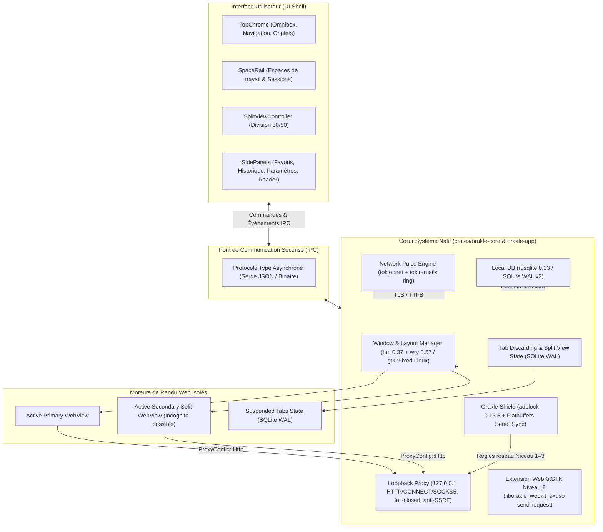

# Orakle Browser — Spécification d'Architecture Technique

- **Version** : 2.0.0
- **Statut** : Document d'architecture de référence (aligné Phase 5)
- **Dernière mise à jour** : 2026-11-13

---

## 1. Principes Directeurs d'Architecture

1. **Séparation Stricte des Responsabilités** :
   Le cœur applicatif et les opérations critiques résident dans des modules **Rust natifs**. L'interface utilisateur (*UI Shell*) est découplée de l'implémentation bas-niveau du moteur Web.
2. **Moindre Privilège & Cloisonnement** :
   Le contenu Web distant est strictement isolé du système d'exploitation. Aucun script provenant d'une page Web ne peut invoquer directement d'API système ou de commande privilégiée.
3. **Zéro Échec Silencieux (Fail-Closed & Explicit Error Handling)** :
   Toutes les erreurs d'E/S, de réseau, de parsing ou de persistance sont typées via `Result<T, OrakleError>` en Rust, sans panics incontrôlés en production.
4. **Honnêteté Technique & Efficacité Énergétique** :
   Les onglets inactifs sont suspendus pour préserver la mémoire vive (RAM) et la batterie sur les machines portables. Les statistiques de performance et de sécurité reflètent des mesures réelles du système.

---

## 2. Diagramme des Composants Globaux

---

## 3. Description Détaillée des Modules Rust

### A. Module `orakle-core::storage` (Persistance Locale)
- **Technologie** : SQLite WAL via `rusqlite` 0.33 avec transactions atomiques (`ACID`) et intégrité référentielle (`PRAGMA foreign_keys = ON`).
- **Responsabilités** :
  - Tables `tabs` / `spaces`, `bookmarks`, `history` et `settings` pour la persistance et la suspension des onglets (mesuré à **3,91 µs/entrée** en release dans `poc_validation` et **19,04 µs/entrée** en debug sur 1 000 insertions).
- **Sécurité des secrets (cible Phase 4)** : Délégation vers les coffres-forts OS (`Secret Service` Linux, `DPAPI` Windows, `Keychain` macOS) prévue pour l'étape d'enregistrement d'identifiants.

### B. Modules `orakle-core::shield` & `orakle-core::proxy` (Bouclier & Proxy Loopback)
- **Technologie** : Crate Rust `adblock` 0.13.5 (`Send + Sync`, features `embedded-domain-resolver` et `full-regex-handling`, sans `single-thread`) couplée au proxy loopback `tokio::net::TcpListener`.
- **Responsabilités** :
  - Filtrage à 3 niveaux (Niveau 1 : Proxy `CONNECT`/HTTP par domaine/URL HTTP ; Niveau 2 : Adaptateurs natifs OS prévus pour sous-ressources HTTPS ; Niveau 3 : Scriptlets/cosmétique sous matrice de compatibilité).
  - Évaluation mesurée de `adblock` : **0,824 µs/requête** en release (`poc_validation`, 10k req.) ; `p50=52,73 µs`, `p95=139,92 µs` en debug (`orakle-core`, 5k req.).
  - Vérification du bouclier **avant résolution DNS** dans `proxy.rs` (zéro fuite DNS vers les domaines bloqués) + validation anti-SSRF / anti-DNS-rebinding (`allow_loopback_upstream = false` par défaut).
  - Télémétrie exacte via `ProxyTelemetry` (`allowed`, `blocked_shield`, `blocked_ssrf`, `errors`, `bytes_proxied`).

### C. Module `orakle-core::pulse` (Diagnostic Pulse)
- **Technologie** : Client `tokio::net::TcpStream` + `tokio-rustls` (`ring`), zéro dépendance OpenSSL.
- **Responsabilités** :
  - Mesure réelle par phase (`dns_ms`, `tcp_ms`, `tls_ms`, `ttfb_ms`, `total_ms`) avec timeout configurable (`5 s` par défaut) et agrégation statistique multi-échantillons (`probe_stats` → `p50` / `p95`, sans ratios fixes).

### D. Hôte Natif `orakle-app` (`tao 0.37` + `wry 0.57`)
- **Responsabilités** :
  - Fenêtre native multi-WebViews (Chrome UI + Split View 30/70, 50/50, 70/30 avec volet droit incognito via `with_incognito(true)`), routage forcé sur `SecureLoopbackProxy` (`ProxyConfig::Http`).
  - Sous Linux X11/Wayland : montage via `gtk::Fixed` + `WebViewBuilderExtUnix::build_gtk`, dimensionnement `LogicalSize`/`PhysicalSize` tenant compte de `scale_factor()`, et terminaison explicite du processus moteur (`terminate_web_process()` + `fixed.remove`) à la fermeture/suspension des onglets (zéro fuite de `WebKitWebProcess` vérifiée sur 30 passes).
  - Gestion complète des téléchargements résumables (`Range` / `206`, pause/reprise/annulation, classification des extensions sans faux AV) via `orakle_core::downloads`.
  - Isolation des profils (`ProfileRegistry` / `ProfileContext`) et sessions privées éphémères (`PrivateSession` avec purge disque à la fermeture).
  - Pages d'erreur natives injectées hors-bande (`load_html` sur `idle_add_local_once` via `pages::classify_webkit_error` + `proxy_running_flag` partagé), sans mascarade ni repli silencieux hors proxy.

---

## 4. Stratégie de Gestion des Erreurs et Résilience

1. **Résistance aux Erreurs Réseau & Plantages de Page** :
   Un échec DNS/TLS/connexion ou un plantage de processus WebKit dans un onglet n'entraîne pas la fermeture du navigateur. `orakle-app::pages` classe l'erreur (incluant la panne proxy `ProxyUnavailable` basée sur l'état réel `proxy_running_flag`) et affiche une page locale informative avec actions de réessai ou rétablissement du proxy.
2. **Politique Fail-Closed & Alertes Explicites** :
   En cas d'arrêt du proxy loopback (`proxy_running_flag = false`), l'interface Chrome affiche une bannière rouge explicite avec bouton de redémarrage immédiat et bloque toute navigation silencieuse directe.
3. **Sauvegarde Atomique** :
   Les préférences, sessions SQLite WAL et profils multi-comptes (`ProfileRegistry`) garantissent la cohérence au redémarrage sans corruption en cas d'arrêt brutal.
