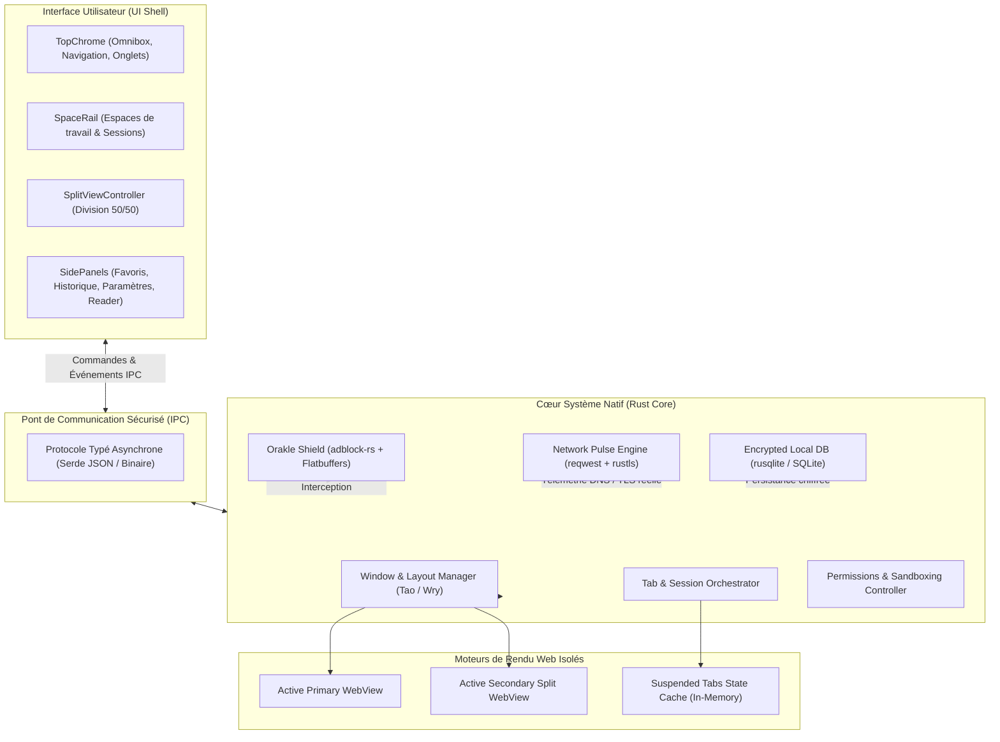

# Orakle Browser — Spécification d'Architecture Technique

- **Version** : 2.0.0
- **Statut** : Document d'architecture de référence
- **Dernière mise à jour** : 2026-11-11

---

## 1. Principes Directeurs d'Architecture

1. **Séparation Stricte des Responsabilités** :
   Le cœur applicatif et les opérations critiques résident dans des modules **Rust natifs**. L'interface utilisateur (*UI Shell*) est découplée de l'implémentation bas-niveau du moteur Web.
2. **Moindre Privilège & Cloisonnement** :
   Le contenu Web distant est strictement isolé du système d'exploitation. Aucun script provenant d'une page Web ne peut invoquer directement d'API système ou de commande privilégiée.
3. **Zéro Échec Silencieux (Fail-Closed & Explicit Error Handling)** :
   Toutes les erreurs d'E/S, de réseau, de parsing ou de persistance sont typées via `Result<T, OrakleError>` en Rust, sans panics incontrôlés en production.
4. **Honnêteté Technique & Efficacité Énergétique** :
   Les onglets inactifs sont suspendus pour préserver la mémoire vive (RAM) et la batterie sur les machines portables. Les statistiques de performance et de sécurité reflètent des mesures réelles du système.

---

## 2. Diagramme des Composants Globaux

---

## 3. Description Détaillée des Modules Rust

### A. Module `orakle-core::storage` (Persistance Locale)
- **Technologie** : SQLite via `rusqlite` avec transactions atomiques (`ACID`).
- **Responsabilités** :
  - `bookmarks` : table des favoris avec hiérarchie de dossiers, tags, dates de création et favicons stockés en blob.
  - `history` : table d'historique avec indexation des URLs et des titres, sans écriture des pages consultées en mode Fantôme.
  - `sessions` : stockage des clichés d'onglets nommés et sérialisés.
  - `settings` : paires clé-valeur typées pour les préférences utilisateur (thème, densité, moteur par défaut).
- **Sécurité** : Chiffrement local au repos des données sensibles (clés, mots de passe enregistrés) via les mécanismes de coffre-fort du système d'exploitation (`Secret Service` sur Linux, `DPAPI` sur Windows, `Keychain` sur macOS).

### B. Module `orakle-core::shield` (Bouclier de Confidentialité)
- **Technologie** : Crate Rust `adblock` (moteur officiel compilé en bytecode natif avec filtres de Bloom).
- **Responsabilités** :
  - Compilation des listes de filtrage (EasyList, Peter Lowe, règles de pistage) en mémoire vive.
  - Évaluation de chaque URL avant requête en moins de **0.2 milliseconde**.
  - Purge des balises de tracking dans les URLs (`utm_*`, `fbclid`, `gclid`, `msclkid`, `twclid`, `_ga`).
  - Injection automatique des en-têtes de refus de pistage `DNT: 1` et `Sec-GPC: 1`.

### C. Module `orakle-core::network` (Diagnostic Pulse)
- **Technologie** : Client HTTP/2 et TLS 1.3 basé sur `reqwest` et `rustls` (zéro dépendance OpenSSL vulnérable).
- **Responsabilités** :
  - Mesure réelle des phases de connexion : temps de résolution DNS (socket UDP non-bloquant), handshake TCP, négociation TLS, et *Time-to-First-Byte* (TTFB).
  - Audit passif des en-têtes HTTP de sécurité (`Strict-Transport-Security`, `Content-Security-Policy`, `X-Frame-Options`, `X-Content-Type-Options`, `Referrer-Policy`, `Permissions-Policy`).

### D. Module `orakle-core::tab_manager` (Cycle de Vie des Onglets)
- **Responsabilités** :
  - Gestion des listes d'onglets ordonnées par espace de travail (*Space*).
  - Politique de gestion de mémoire : maintien d'au maximum deux WebViews actives en rendu simultané (l'onglet principal et l'onglet scindé en mode Split View).
  - Les onglets d'arrière-plan sont mis en état de veille (*suspended*) après un délai configurable d'inactivité, libérant leur thread de rendu tout en préservant leur position dans l'historique et leur URL.

---

## 4. Stratégie de Gestion des Erreurs et Résilience

1. **Résistance aux Plantages de Page** :
   Un crash de processus WebKit ou Chromium dans un onglet n'entraîne pas la fermeture du navigateur. Le conteneur affiche une page d'erreur conviviale permettant de recharger l'onglet en un clic.
2. **Gestion Hors-Ligne** :
   Détection de la perte de connectivité réseau avec affichage d'un état propre et conservation des onglets pour rechargement automatique dès le retour du réseau.
3. **Sauvegarde Atomique** :
   Toutes les écritures de préférences ou de sessions sont effectuées par renommage atomique (`write to temp file then rename`) pour éviter toute corruption de données en cas d'extinction brutale du poste.
