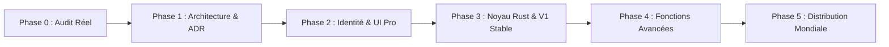

# Orakle Browser — Feuille de Route de Développement (Roadmap)

- **Version** : 2.0.0
- **Statut** : Plan directeur des versions (mise à jour Phase 3)
- **Dernière mise à jour** : 2026-11-13

---

## Vue d'Ensemble des Phases de Développement

---

## Jalons Détaillés

### Phase 0 : Audit Réel et Constats de Départ (Terminée)
- [x] Audit complet des dépendances système (Rust, Cargo, GCC, Clang, GTK, WebKit).
- [x] Analyse objective du prototype existant Electron v1.1.0 (forces et limites).
- [x] Rejet des dérives graphiques cyberpunk / néon et cadrage d'une identité sobre et professionnelle.

### Phase 1 : Architecture Technique, ADR & Preuve de Faisabilité (Terminée)
- [x] Rédaction et validation de l'ADR 0001 comparant Tauri v2 + WRY, Servo et Chromium/CEF.
- [x] Preuve de faisabilité technique (POC) Rust exécutée et documentée (`docs/VALIDATION/POC-TAURI-WRY.md`) :
  - Benchmark réel `adblock` v0.13.5 : 0,824 µs / requête (10 000 itérations).
  - Benchmark réel persistance SQLite WAL : 3,91 µs / entrée avec rollback ACID vérifié.
  - Sonde Pulse réelle sur sockets TCP/DNS (suppression définitive des pourcentages simulés).
  - Démonstration de l'architecture d'interception réseau via Proxy Loopback Rust SNI.
- [x] Définition des documents de cadrage : `PRODUCT_REQUIREMENTS.md`, `ARCHITECTURE.md`, `DESIGN_SYSTEM.md`, `SECURITY_MODEL.md`, `TEST_STRATEGY.md`.
- [x] Rendu haute définition des maquettes graphiques V2 sobres (1080p, thèmes sombre et clair).

### Phase 2 : Identité Visuelle et Nouvelle Interface Professionnelle
- [ ] Création du nouveau logo officiel Orakle Browser (vectoriel SVG, lisible en 16x16, 32x32, 128x128 et 512x512).
- [ ] Refonte de l'interface UI Shell selon la charte « Ardoise & Bleu Pétrole » :
  - Omnibox ergonomique épurée avec indicateurs de sécurité clairs.
  - Barre d'onglets compacte commutable (horizontale / verticale).
  - Écran scindé (Split View) avec redimensionnement fluide.
  - Page d'accueil sobre avec horloge élégante et accès rapides.
  - Paramètres structurés par catégories avec interrupteurs fonctionnels.

### Phase 3 : Implémentation du Cœur Rust & Validation Moteur Réelle (Validée sur socle `orakle-core` + `orakle-app`)
- [x] Workspace Rust fonctionnel sous [`crates/orakle-core`](file:///run/media/niceman/Nice/ProjetsWeb/Orakle-Browser/crates/orakle-core/Cargo.toml) (`storage`, `shield` `Send+Sync`, `pulse` multi-échantillons, `proxy` fail-closed anti-DNS-rebinding) et [`crates/orakle-app`](file:///run/media/niceman/Nice/ProjetsWeb/Orakle-Browser/crates/orakle-app/Cargo.toml) (`tao 0.37` + `wry 0.57`).
- [x] Preuves empiriques du Proxy Loopback Rust : suite E2E `proxy_server_e2e.rs`, harnais réel `WebKit2GTK 4.1` (`scripts/verify-webview-proxy.py`) et vérification NetLog Chromium (`0` session QUIC / bascule `h2`).
- [x] Validation multi-WebViews (Chrome UI + Split View 50/50 sous `gtk::Fixed`, volet incognito, redimensionnement dynamique, Tab Discarding SQLite WAL mesuré à `-181,7 Mio VmRSS`).
- [ ] Compléter le cycle de vie interactif complet des onglets, l'historique navigation/favoris UI et le sélecteur de thèmes persistant dans `chrome.html`.

### Phase 4 : Fonctions Avancées & Filtrage Niveau 2/3
- [ ] Ajouter le support **SOCKS5** au proxy loopback (nécessaire pour `ws://` sous WebKitGTK).
- [ ] Implémenter les adaptateurs natifs OS Niveau 2 (`WebView2 WebResourceRequested`, `WebKitWebExtension`, `WKContentRuleListStore`) et la prise en charge ciblée Niveau 3 (cosmétique / scriptlets / `$removeparam`).
- [ ] Mode Lecture (Orakle Reader), gestionnaire des cookies/purge sélective et intégration des coffres-forts secrets OS.
- [ ] Exposer la sonde Pulse multi-échantillons et la télémétrie `ProxyTelemetry` dans le panneau latéral Chrome.

### Phase 5 : Stabilisation, Tests et Distribution
- [ ] Packaging Linux natif : `.deb` (Debian/Ubuntu/Kali), AppImage et tarball binaire.
- [ ] Packaging Windows natif : installeur `.msi` avec signature d'intégrité.
- [ ] Suite de tests automatisés (unitaires Rust, tests d'intégration UI Playwright/WebDriver).
- [ ] Documentation utilisateur et site officiel de téléchargement.
