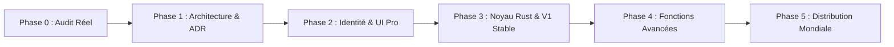

# Orakle Browser — Feuille de Route de Développement (Roadmap)

- **Version** : 2.0.0
- **Statut** : Plan directeur des versions
- **Dernière mise à jour** : 2026-11-11

---

## Vue d'Ensemble des Phases de Développement

---

## Jalons Détaillés

### Phase 0 : Audit Réel et Constats de Départ (Terminée)
- [x] Audit complet des dépendances système (Rust, Cargo, GCC, Clang, GTK, WebKit).
- [x] Analyse objective du prototype existant Electron v1.1.0 (forces et limites).
- [x] Rejet des dérives graphiques cyberpunk / néon et cadrage d'une identité sobre et professionnelle.

### Phase 1 : Architecture Technique, ADR & Preuve de Faisabilité (Terminée)
- [x] Rédaction et validation de l'ADR 0001 comparant Tauri v2 + WRY, Servo et Chromium/CEF.
- [x] Preuve de faisabilité technique (POC) Rust exécutée et documentée (`docs/VALIDATION/POC-TAURI-WRY.md`) :
  - Benchmark réel `adblock` v0.13.5 : 0,824 µs / requête (10 000 itérations).
  - Benchmark réel persistance SQLite WAL : 3,91 µs / entrée avec rollback ACID vérifié.
  - Sonde Pulse réelle sur sockets TCP/DNS (suppression définitive des pourcentages simulés).
  - Démonstration de l'architecture d'interception réseau via Proxy Loopback Rust SNI.
- [x] Définition des documents de cadrage : `PRODUCT_REQUIREMENTS.md`, `ARCHITECTURE.md`, `DESIGN_SYSTEM.md`, `SECURITY_MODEL.md`, `TEST_STRATEGY.md`.
- [x] Rendu haute définition des maquettes graphiques V2 sobres (1080p, thèmes sombre et clair).

### Phase 2 : Identité Visuelle et Nouvelle Interface Professionnelle
- [ ] Création du nouveau logo officiel Orakle Browser (vectoriel SVG, lisible en 16x16, 32x32, 128x128 et 512x512).
- [ ] Refonte de l'interface UI Shell selon la charte « Ardoise & Bleu Pétrole » :
  - Omnibox ergonomique épurée avec indicateurs de sécurité clairs.
  - Barre d'onglets compacte commutable (horizontale / verticale).
  - Écran scindé (Split View) avec redimensionnement fluide.
  - Page d'accueil sobre avec horloge élégante et accès rapides.
  - Paramètres structurés par catégories avec interrupteurs fonctionnels.

### Phase 3 : Première Version Fonctionnelle (Cœur Rust & Navigation Réelle)
- [ ] Initialisation du projet Rust sous `crates/orakle-core` et `crates/orakle-app`.
- [ ] Intégration de Tauri v2 + WRY pour l'affichage de véritables pages Web.
- [ ] Cycle de vie complet des onglets : ouverture, fermeture, réorganisation, navigation (Précédent, Suivant, Actualiser, Arrêt).
- [ ] Persistance atomique des favoris et de l'historique dans une base SQLite locale.
- [ ] Prise en charge des thèmes Sombre / Clair / Système avec bascule persistante.

### Phase 4 : Fonctions Avancées & Confidentialité Active
- [ ] Intégration du moteur `adblock-rs` avec règles EasyList compilées en mémoire.
- [ ] Nettoyage automatique des paramètres de pistage d'URL (`utm_*`, `fbclid`, etc.).
- [ ] Mode Fantôme (Navigation Privée en RAM sans écriture disque).
- [ ] Mode Lecture (Orakle Reader) avec extraction locale Readability.
- [ ] Gestionnaire des cookies et de purge sanitaire sélective.
- [ ] Sonde de latence réseau Pulse (DNS, TLS, TTFB réels).

### Phase 5 : Stabilisation, Tests et Distribution
- [ ] Packaging Linux natif : `.deb` (Debian/Ubuntu/Kali), AppImage et tarball binaire.
- [ ] Packaging Windows natif : installeur `.msi` avec signature d'intégrité.
- [ ] Suite de tests automatisés (unitaires Rust, tests d'intégration UI Playwright/WebDriver).
- [ ] Documentation utilisateur et site officiel de téléchargement.
