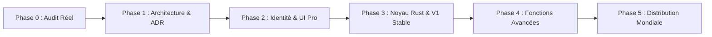

# Orakle Browser — Feuille de Route de Développement (Roadmap)

- **Version** : 2.0.0
- **Statut** : Plan directeur des versions (mise à jour Phase 5)
- **Dernière mise à jour** : 2026-11-13

---

## Vue d'Ensemble des Phases de Développement

---

## Jalons Détaillés

### Phase 0 : Audit Réel et Constats de Départ (Terminée)
- [x] Audit complet des dépendances système (Rust, Cargo, GCC, Clang, GTK, WebKit).
- [x] Analyse objective du prototype existant Electron v1.1.0 (forces et limites).
- [x] Rejet des dérives graphiques cyberpunk / néon et cadrage d'une identité sobre et professionnelle.

### Phase 1 : Architecture Technique, ADR & Preuve de Faisabilité (Terminée)
- [x] Rédaction et validation de l'ADR 0001 comparant Tauri v2 + WRY, Servo et Chromium/CEF.
- [x] Preuve de faisabilité technique (POC) Rust exécutée et documentée (`docs/VALIDATION/POC-TAURI-WRY.md`) :
  - Benchmark réel `adblock` v0.13.5 : 0,824 µs / requête (10 000 itérations).
  - Benchmark réel persistance SQLite WAL : 3,91 µs / entrée avec rollback ACID vérifié.
  - Sonde Pulse réelle sur sockets TCP/DNS (suppression définitive des pourcentages simulés).
  - Démonstration de l'architecture d'interception réseau via Proxy Loopback Rust SNI.
- [x] Définition des documents de cadrage : `PRODUCT_REQUIREMENTS.md`, `ARCHITECTURE.md`, `DESIGN_SYSTEM.md`, `SECURITY_MODEL.md`, `TEST_STRATEGY.md`.
- [x] Rendu haute définition des maquettes graphiques V2 sobres (1080p, thèmes sombre et clair).

### Phase 2 : Identité Visuelle et Nouvelle Interface Professionnelle
- [ ] Création du nouveau logo officiel Orakle Browser (vectoriel SVG, lisible en 16x16, 32x32, 128x128 et 512x512).
- [ ] Refonte de l'interface UI Shell selon la charte « Ardoise & Bleu Pétrole » :
  - Omnibox ergonomique épurée avec indicateurs de sécurité clairs.
  - Barre d'onglets compacte commutable (horizontale / verticale).
  - Écran scindé (Split View) avec redimensionnement fluide.
  - Page d'accueil sobre avec horloge élégante et accès rapides.
  - Paramètres structurés par catégories avec interrupteurs fonctionnels.

### Phase 3 : Implémentation du Cœur Rust & Validation Moteur Réelle (Validée sur socle `orakle-core` + `orakle-app`)
- [x] Workspace Rust fonctionnel sous [`crates/orakle-core`](file:///run/media/niceman/Nice/ProjetsWeb/Orakle-Browser/crates/orakle-core/Cargo.toml) (`storage`, `shield` `Send+Sync`, `pulse` multi-échantillons, `proxy` fail-closed anti-DNS-rebinding) et [`crates/orakle-app`](file:///run/media/niceman/Nice/ProjetsWeb/Orakle-Browser/crates/orakle-app/Cargo.toml) (`tao 0.37` + `wry 0.57`).
- [x] Preuves empiriques du Proxy Loopback Rust : suite E2E `proxy_server_e2e.rs`, harnais réel `WebKit2GTK 4.1` (`scripts/verify-webview-proxy.py`) et vérification NetLog Chromium (`0` session QUIC / bascule `h2`).
- [x] Validation multi-WebViews (Chrome UI + Split View 50/50 sous `gtk::Fixed`, volet incognito, redimensionnement dynamique, Tab Discarding SQLite WAL).
- [x] Cycle de vie interactif complet des onglets, historique/favoris/notes/téléchargements/sessions UI et sélecteur de thèmes persistant livrés en Phase 4.

### Phase 4 : Intégration Native Complète, Split View, Bouclier Niveau 1–2 & Benchmark Réel (Validée sous Linux — voir [`PHASE4-REPORT.md`](file:///run/media/niceman/Nice/ProjetsWeb/Orakle-Browser/docs/VALIDATION/PHASE4-REPORT.md))
- [x] Proxy loopback étendu avec **SOCKS5 (RFC 1928)** pour WebSockets (`ws://`), IPv6 `[::1]` et vérifications pré-DNS (`crates/orakle-core/src/proxy.rs`).
- [x] Extension native Linux Niveau 2 [`crates/orakle-webkit-ext`](file:///run/media/niceman/Nice/ProjetsWeb/Orakle-Browser/crates/orakle-webkit-ext/Cargo.toml) (`liborakle_webkit_ext.so` / `send-request`) connectée à `ShieldEngine` avec télémétrie IPC vérifiée (`natif=5`), plus spécification Windows (`WebView2`) et compilateur unitaire macOS (`WKContentRuleListStore`).
- [x] Interface complète [`chrome.html`](file:///run/media/niceman/Nice/ProjetsWeb/Orakle-Browser/crates/orakle-app/src/chrome.html) + [`panel.html`](file:///run/media/niceman/Nice/ProjetsWeb/Orakle-Browser/crates/orakle-app/src/panel.html) (Top bar, onglets, Split View 30/70/50/50/70/30 + swap + focus + sync scroll, Espaces, Notes, Favoris, Historique, Téléchargements, Pulse multi-échantillons, Profils & Mode Privé).
- [x] Benchmark mémoire/CPU cgroup v2 & PSS réel sur 8 scénarios × 3 passes (`--bench`) et captures PNG réelles de l'application exécutée.
- [ ] Intégration des coffres-forts secrets OS (`libsecret` / `DPAPI` / `Keychain`), Mode Lecture (Reader) et validation sur hôtes réels Windows/macOS.

### Phase 5 : Hardening Produit, Optimisation, Sécurité & Préparation Distribution (Validée Linux — voir [`PHASE5-REPORT.md`](file:///run/media/niceman/Nice/ProjetsWeb/Orakle-Browser/docs/VALIDATION/PHASE5-REPORT.md))
- [x] Omnibox réelle (URL, domaines sans schéma, Bangs `!gh`/`!w`/..., suggestions multi-sources Favoris + Historique + Onglets ouverts en menu superposé).
- [x] Téléchargements résumables (`HTTP 206`/`Range`), pause/reprise/annulation, classification honnête des extensions et persistance SQLite (`crates/orakle-core/src/downloads.rs`).
- [x] Pages d'erreur WebView natives injectées (`pages.rs` + `proxy_running_flag`) et bannière explicite de panne proxy fail-closed.
- [x] Multi-profils isolés (`ProfileRegistry`), sessions privées éphémères (`PrivateSession`) et audit anti-SSRF 302 / anti-CSRF loopback (`phase5_security_and_profiles.rs`).
- [x] Correction fuite `WebKitWebProcess` (`terminate_web_process()` + `fixed.remove()`), benchmark isolé cgroup v2 sur **30 passes** + 1 warmup (`phase5_bench_results.json`), validation X11 + Wayland + `GDK_SCALE=2`.
- [x] Packaging Linux `.deb` compilé et vérifié (`packaging/linux/build-deb.sh` + `.sha256`), AppDir préparé (`build-appimage.sh`, `appimagetool` absent localement), scripts/manifests modèles Windows `.wxs` et macOS `.sh` documentés (non compilés hors cible).
- [ ] Intégration coffres-forts OS (`libsecret` / `DPAPI` / `Keychain`), signature GPG/Authenticode/Notarization en CI et compilation hôte réelle Windows/macOS.
